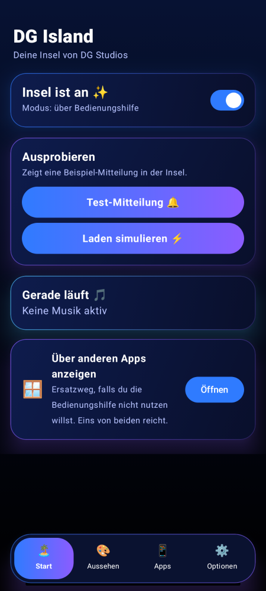

# DG Island 🏝️

Dynamic Island für Android – von **DG Studios**.

- Schwarze Insel oben am Kamera-Loch mit Feder-Animationen
- Mitteilungen mit App-Symbol (Tippen öffnet, Wischen blendet aus)
- Musik mit Cover, Steuerung und Equalizer
- Laden-Anzeige, Anrufe und Timer live
- Position, Größe und Ecken einstellbar, App-Filter, Autostart

Ab Android 8.0. Download: siehe [Releases](../../releases).

